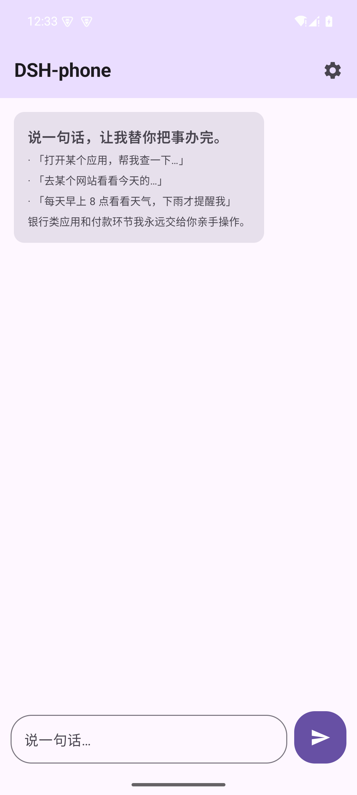
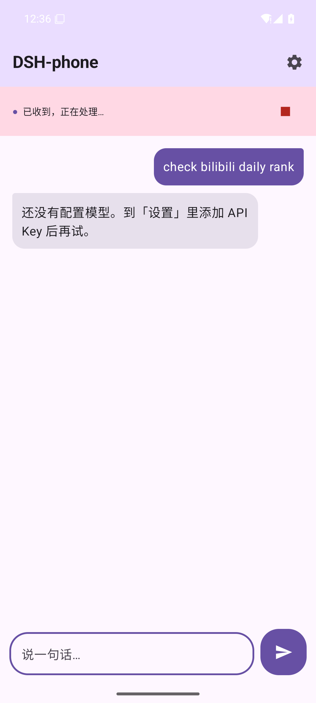
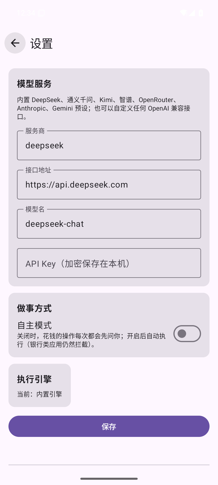

<div align="center">


# DSH-phone

**Say one sentence. The phone gets it done.**

DSH-phone is a personal AI assistant that runs on your Android phone. It operates apps and websites in the background while your screen stays yours. Bank apps, payments and system settings sit behind explicit gates — it does the work, you keep the decisions.

[中文](README.md) | English

</div>

---

## What it does

DSH-phone doesn't adapt app-by-app. It works like a person sitting next to your phone: it reads the screen, understands what's there, taps and types, and pushes the task to the end.

| Capability | Details |
|---|---|
| **App control** | Reads the view hierarchy through the accessibility service, launches apps, taps, types, scrolls and navigates back. It looks before it acts: every tap is confirmed against the screen first. |
| **Web control** | A private built-in browser in desktop mode: real clicks and typing, images blocked, rate-limited between visits. Risk-control pages are handed back to you, never fought. |
| **Steering** | Drop a mid-task message ("also make the title red") while the task runs. Finished work is kept, the in-flight model request is dropped and re-asked with the steer appended — nothing is lost. |
| **Outward pacing** | Irreversible outward actions (send, submit, apply) on the same site or app are spaced 8–20 seconds apart with random jitter; the interval grows with recent volume. |
| **Local memory** | Remembers preferences you explicitly stated; view, edit or delete them anytime. Passwords, OTP codes and card numbers are filtered before they ever reach storage. |
| **Scheduled & conditional tasks** | One-shot reminders, periodic checks, and condition-gated tasks ("only if it rains"). When a condition can't be evaluated, it skips the round instead of firing blindly. |
| **Takeover** | For logins, captchas and payments it notifies you and pauses. Hand back when done and it verifies the scene before continuing. After 10 unattended minutes it ends honestly. |

## Screens

| Chat | Task running | Settings |
|---|---|---|
|  |  |  |

## How it works

Two Gradle modules with a clean split:

```
:core   Pure Kotlin, no Android
        Scheduling-only main loop · model clients (OpenAI-compatible / Anthropic / Gemini)
        Tool declaration with folding groups · single execution entry · risk grading · outward pacing
        Run inbox (steer / answer / confirm / hand-back / cancel) · evidence ledger · memory · triggers

:app    Android host
        Accessibility-driven phone capability · built-in browser · chat UI · settings · capability check
        Notification channels with lockscreen privacy · floating capsule · ColorOS keep-alive · encrypted storage
```

Design decisions worth knowing:

- **The main loop only schedules.** Every judgement lives in a small testable piece: turn policy, stop rules (repeated actions, failure streaks, empty replies). The core runs on the JVM against a fake model.
- **Tools are policed by properties, not names.** Each tool declares its risk (read / write / external), its capability, and whether it's an entry; an entry call unfolds the whole group. Before unfolding the model sees entries only, so request prefixes stay stable.
- **One execution entry.** Every world-changing action passes the same path: host safety policy → payment approval → outward pacing → perform → record. Callers cannot construct a bypass.
- **Steering never rolls back.** A steer supplements; it never replaces.

## Safety design

| Layer | Rule |
|---|---|
| **Bank apps** | Hard-deny. No toggle, no exception. |
| **Payments** | Asked every time by default (one action per approval); refused outright on unattended runs. |
| **Messaging apps** | Outbound sends confirmed one by one; never sent when nobody is present. |
| **System settings** | Read-only by default; a write grant lasts exactly one task. |
| **Itself** | Never operates its own UI, so it can't approve itself. |
| **Sensitive data** | Never types passwords, OTPs or card numbers; the same patterns are filtered from memory. |

## Privacy

- No cloud server. Conversation and screen data go only to the model provider you configure.
- The API key is stored with Android Keystore encryption; memory and run records stay on the device.

## Build from source

```bash
git clone https://github.com/CottonChou/DSH-phone.git
cd DSH-phone
./gradlew :app:assembleDebug
./gradlew :core:test
```

Requires JDK 21 and the Android SDK (compileSdk 35).

## License

[Apache-2.0](LICENSE)
