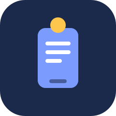
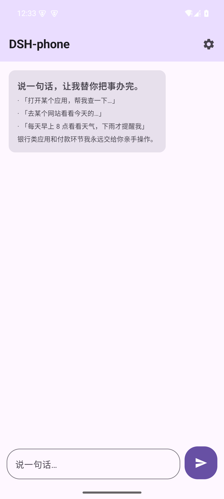
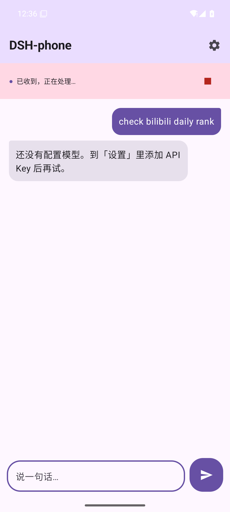
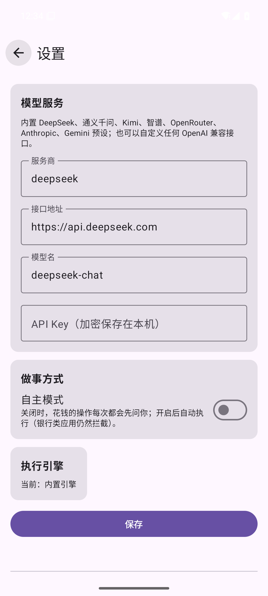

<div align="center">



# DSH-phone

**说一句话，手机替你把事办完。**

DSH-phone 是一个跑在你手机上的私人 AI 助理：它在后台替你操作应用和网页，你的屏幕始终归你自己用。它对银行类应用、付款环节和系统设置有明确的拦截与确认策略——该它做的它做，该你拍板的它绝不越界。

An on-device Android agent that turns one sentence into a finished task. It works in the background, brings your own model key, and puts explicit safety gates in front of anything that matters.


[下载](#下载) · [开始用](#开始用) · [它是怎么工作的](#它是怎么工作的) · [安全设计](#安全设计) · [参与建设](#参与建设)

简体中文 | [English](README.en.md)

</div>

---

## 它能做什么

DSH-phone 的能力不靠逐个 App 适配。它像一个真正坐在你手机旁边的人：看界面、理解内容、点按和输入，把任务推进到结束。

| 能力 | 说明 |
|---|---|
| **应用操作** | 通过无障碍服务读取当前屏幕、启动应用、点击、输入、滚动和返回。先看清再动手：每次点击前它都会先读屏确认目标。 |
| **网页操作** | 内置的私有浏览器以电脑版方式打开网站，真实点击和输入；禁图加载、连续访问限速，识别到风控页不硬闯，交还给你处理。 |
| **插话** | 任务跑着的时候你可以随时补充一句话（「顺便把标题改成红色」）。已做的事一概保留，新话接在后面，正在等模型的请求立刻撤回重问，什么都不会丢。 |
| **节奏保护** | 对外动作（发送、提交、打招呼）在同一网站或应用里连续做时自动拉开 8–20 秒随机间隔，动作越密间隔越长，避免像机器人。 |
| **本地记忆** | 记住你明确说过的偏好和做法，可查可删；密码、验证码、卡号在入库前就被拦下，永远不写进记忆。 |
| **定时与条件任务** | 一次性提醒、周期任务和「下雨才提醒我」这类条件任务。条件判不了的时候宁可跳过这轮，不盲目执行。 |
| **随时接管** | 登录、验证码、付款这类只有你能做的事，会通知你接管；处理完交还，它会先核实现场再继续。10 分钟没人处理就如实收尾，不装死也不硬等。 |

## 界面

| 对话 | 任务运行 | 设置 |
|---|---|---|
|  |  |  |

## 它是怎么工作的

两个 Gradle 模块，职责分得很干净：

```
:core   纯 Kotlin，不碰安卓
        主循环只做调度 · 模型客户端（OpenAI 兼容 / Anthropic / Gemini）
        工具声明与折叠分组 · 唯一执行入口 · 风险分级 · 对外节奏
        收件箱（插话 / 回答 / 确认 / 交还 / 取消）· 证据账本 · 记忆 · 触发器

:app    安卓宿主
        无障碍手机能力 · 内置浏览器 · 会话界面 · 设置 · 能力自检
        通知渠道与锁屏隐私 · 悬浮胶囊 · ColorOS 保活入口 · 加密存储
```

几个值得知道的设计决定：

- **主循环只调度**。判断都住在小件里：步进策略、停止规则（重复同一动作、连续失败、空回复）、意图门槛。所有判断都能单测，核心在电脑上用假模型就能跑。
- **工具按属性办事，不写死名字**。每个工具声明自己的风险（读 / 写 / 对外）、所属能力和是否为入口；入口调用展开整组工具，展开前模型只见入口，请求前缀保持稳定。
- **单一执行入口**。所有改变世界的动作走同一条路：宿主安全策略 → 付款确认 → 对外节奏 → 执行 → 记录。调用方拿不到绕过的通道。
- **插话不回滚**。插话是补充，不是替换：每句插话都会撤掉此刻在等的模型请求，接在完整历史后面重问。

## 安全设计

| 层 | 规则 |
|---|---|
| **银行类应用** | 直接硬拒绝，没有开关，不提供例外。 |
| **付款动作** | 默认每次都问（只放行紧接的那一个操作）；无人在场的运行直接拒绝。自主模式下判定照跑，但付款仍不可代点。 |
| **通讯类应用** | 对外发送逐次确认；无人在场时不允许代发消息。 |
| **系统设置** | 默认只读；确需修改时按本次任务授权，任务结束授权自动失效。 |
| **本应用自身** | 不操作自己的界面，杜绝自我审批。 |
| **敏感信息** | 不代填密码、验证码、卡号；记忆入库前过滤同样模式。 |

## 数据与隐私

- 没有云端服务器。对话内容和屏幕数据只发给你自己配置的模型服务商。
- API Key 用 Android Keystore 加密保存，记忆和运行记录留在本机。
- 内置浏览器不加载图片、只访问你让它去的地址。

## 下载

从 [Releases](../../releases) 下载 APK 安装。要求 Android 13+，执行任务需要开启无障碍服务（应用内的「系统能力自检」页可逐项开启）。

## 开始用

1. 安装并打开 DSH-phone。
2. 到「设置」添加模型：预置 DeepSeek、通义千问、Kimi、智谱、OpenRouter、Anthropic、Gemini；其他服务商选自定义，OpenAI 兼容、Anthropic、Gemini 协议都能接。也支持局域网里的本地模型。
3. 回到对话，试着说：

- 「打开某个应用，帮我看看……」
- 「去某个网站查一下今天的……，总结给我」
- 「每天早上 8 点看看天气，下雨才提醒我」

## 从源码构建

```bash
git clone https://github.com/CottonChou/DSH-phone.git
cd DSH-phone
./gradlew :app:assembleDebug      # 产物在 app/build/outputs/apk/debug/
./gradlew :core:test              # 核心逻辑单测（不需要安卓环境）
```

要求：JDK 21、Android SDK（compileSdk 35）。

## 参与建设

项目还在早期（v0.1.0），欢迎 Issue 和 PR。想动手前先看 [docs/architecture.md](docs/architecture.md) 和 [docs/roadmap.md](docs/roadmap.md)。

## 免责声明

自动化操作第三方应用和网站可能违反对方协议，存在账号被限制的风险。请自行判断并承担使用风险；涉及金钱、账号和重要消息时，建议保持询问模式并检查结果。

## License

[Apache-2.0](LICENSE)
